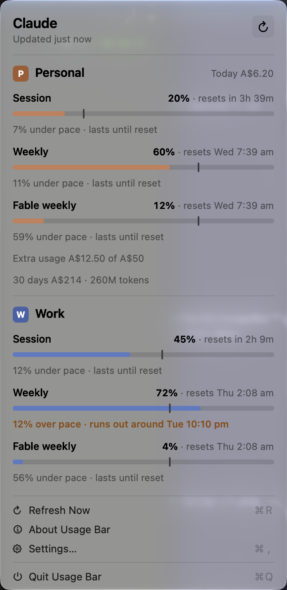
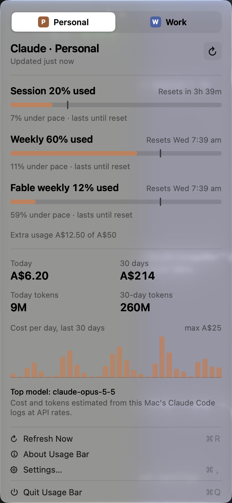
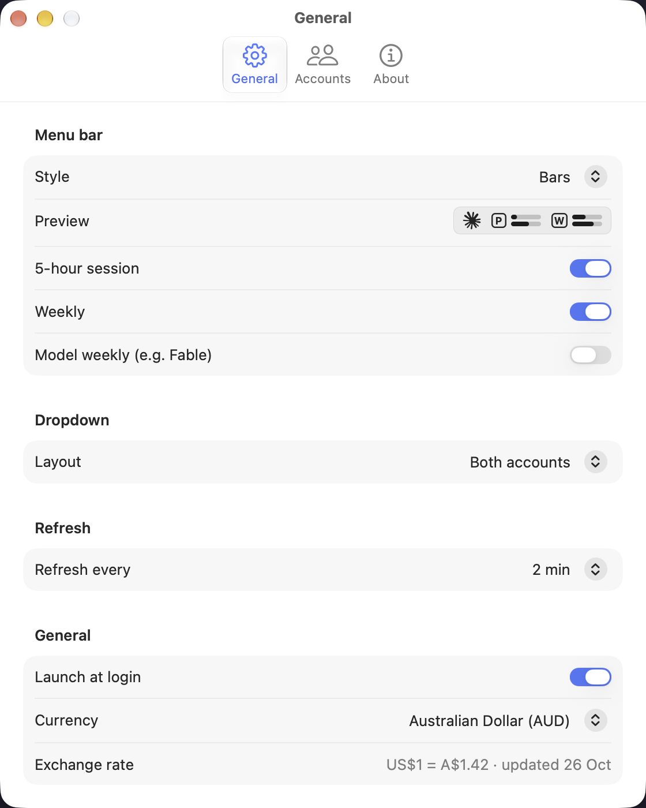
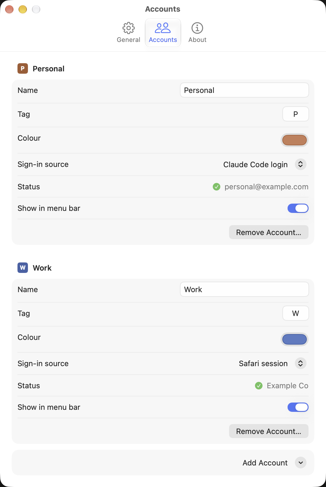
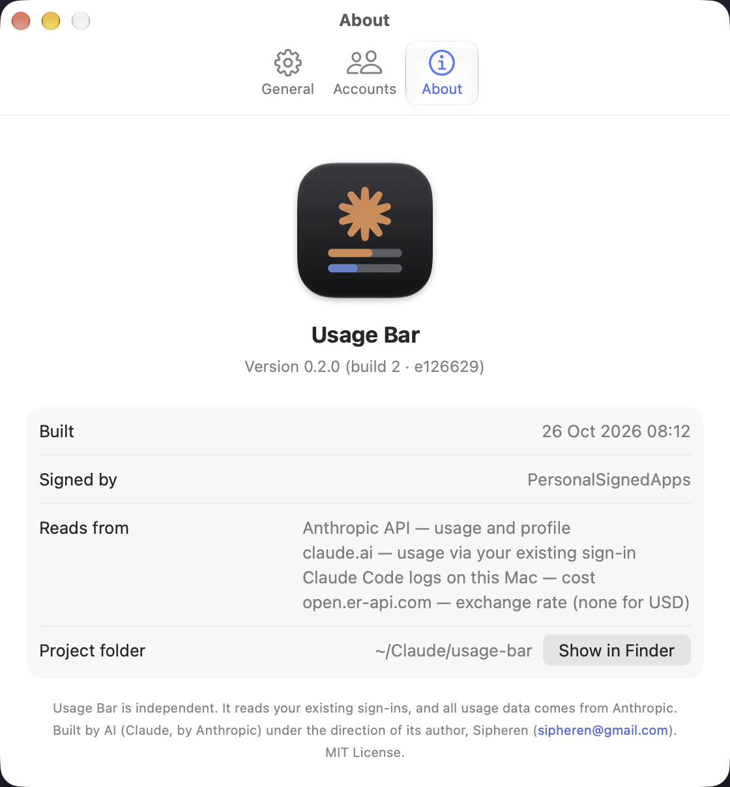

# Usage Bar

Usage Bar shows your Claude plan limits for one or more accounts at once, in the macOS menu bar or the
Windows tray: the 5-hour session, the weekly limit and any model-scoped weekly limit, each with a pace marker. It also
estimates what your Claude Code usage would cost at API prices.

It reads sign-ins you already have (Claude Code, the Claude desktop app, or a browser session). It has
no sign-in flow of its own, never writes to another app's files and never stores a token.

MIT licensed (see [LICENSE](LICENSE)). Usage Bar is an independent project, not made or endorsed by
Anthropic.


| All accounts (default) | One at a time |
|---|---|
|  |  |

| General | Accounts | About |
|---|---|---|
|  |  |  |

The screenshots come from the macOS app in demo mode, so every number and name in them is made up. The
Windows screenshots are in [windows/README.md](windows/README.md).

## Platforms

| Platform | Status | Folder | Details |
|---|---|---|---|
| macOS 26 or later, Apple silicon | Available (0.3.3) | `macos/` | [macos/README.md](macos/README.md) |
| Windows 11 | Available (0.1.9) | `windows/` | [windows/README.md](windows/README.md) |

The macOS app is the reference implementation. Every platform follows the same data contract
([docs/DATA-SOURCES.md](docs/DATA-SOURCES.md)) and product spec ([docs/SPEC.md](docs/SPEC.md)).

## Features

- One or more accounts side by side, up to one per sign-in source (Claude Code, the Claude desktop app,
  a browser session), each with its own colour and tag. The first launch adds only the sign-ins it
  finds; with just one, it shows just the one.
- A monochrome menu bar label on macOS: Bars (default), Percentages (`P 20% / 60%`), Compact
  (`P 20·60`) or Icon only. On Windows, one tray icon per account in that account's colour (Bars or
  Percentages), or a single icon. Usage never changes a colour.
- A dropdown with each limit's percentage, reset time, a pace marker and a pace sentence such as
  "7% under pace · lasts until reset" or "12% over pace · runs out around Wed 7 pm".
- A cost estimate from the Claude Code logs on that computer: today, last 30 days, tokens, a 30-day
  chart and the top model, at current API prices, in the currency you pick (AUD by default; USD, EUR,
  GBP, NZD, CAD, JPY, or your own locale's currency).
- Extra usage (pay-as-you-go credits) when the plan has it.
- Rate-limit friendly: a 429 pauses one account and keeps its last numbers on screen.

## Download

Each release on the [Releases page](https://github.com/Sipheren/usage-bar/releases) has a source zip
for its platform: `usage-bar-macos-<version>.zip` or `usage-bar-windows-<version>.zip`. Unzip it, then
one command tests, builds and installs the app. `INSTALL.txt` in the zip has the requirements and steps.

macOS (macOS 26 or later, Apple silicon, Xcode 26 or later), in Terminal from the unzipped folder:

```bash
bash macos/scripts/install.sh
```

Windows (Windows 11, the .NET 10 SDK): unblock the zip first (right-click > Properties > Unblock),
extract it, then double-click `Install.cmd` in the extracted folder, or run:

```powershell
powershell -ExecutionPolicy Bypass -File windows\scripts\install.ps1
```

## Build from a clone

### macOS

```bash
git clone <this repository's URL> usage-bar
cd usage-bar
scripts/setup-dev.sh          # git hooks and config/local.env
macos/scripts/install.sh      # checks, tests, build, sign, install, open
```

The first launch adds an account for each sign-in it finds on the Mac: the Claude Code login, and the
Claude desktop app when it's signed in to a different account. To add a Safari session, or change anything, open the menu bar item and choose
**Settings… > Accounts**. Requirements, signing, permissions, uninstalling and troubleshooting:
[macos/README.md](macos/README.md).

### Windows

```powershell
bash scripts/setup-dev.sh                                              # in Git Bash: git hooks and config/local.env
powershell -ExecutionPolicy Bypass -File windows\scripts\install.ps1   # tests, build, install, start
```

The first launch adds an account for each sign-in it finds, as on the Mac. Windows 11 puts new tray
icons in the overflow (`^`): drag Usage Bar's icons onto the taskbar. To add or change accounts, open
**Settings… > Accounts** from the flyout. Details and screenshots: [windows/README.md](windows/README.md).

## Using it with friends

- Each person needs their own Claude account (a Pro or Max plan shows the most limits). Usage Bar
  shows the accounts signed in on that computer; it can't see anyone else's.
- Each account picks its own sign-in source: the Claude Code login, the Claude desktop app login, or
  a claude.ai browser session (Safari on macOS; Windows has no browser source yet).
- No data leaves the computer except requests to Anthropic for usage and profile, and one daily
  exchange-rate request when costs show in a currency other than US dollars. The full list is in
  [docs/DATA-SOURCES.md](docs/DATA-SOURCES.md).

## Repository layout

```
macos/             The macOS app: Swift package (Sources/, Tests/), VERSION, scripts/, README.md
windows/           The Windows app: .NET solution (src/, tests/), VERSION, scripts/, README.md
docs/              Shared docs: data sources (the cross-platform contract), spec, decisions, porting,
                   devlog, screenshots; docs/macos/ holds the macOS architecture and development notes
design/            Shared design assets: icon/ (app icon), spark/ (the tray/menu bar spark as SVG),
                   mockup/ (the original HTML mockups)
scripts/           Repository-wide scripts: setup-dev.sh, check-secrets.sh and its allow list,
                   release.sh (builds a platform's source release zip)
scripts/release/   Files added to the top of the release zips: INSTALL.txt, and Install.cmd on Windows
config/            local.env.example (copy to local.env, which git ignores)
.githooks/         pre-commit: runs scripts/check-secrets.sh on staged files
```

## Documentation

- [AGENTS.md](AGENTS.md): working rules for coding agents on any platform. Read it first.
- [docs/DATA-SOURCES.md](docs/DATA-SOURCES.md): sign-in sources, endpoints, response shapes, log
  format, prices.
- [docs/SPEC.md](docs/SPEC.md): the product spec.
- [docs/PORTING.md](docs/PORTING.md): the Windows port's brief, with what was verified on Windows.
- [windows/README.md](windows/README.md): installing, using and developing the Windows app.
- [docs/DECISIONS.md](docs/DECISIONS.md): why things are the way they are.
- [docs/macos/ARCHITECTURE.md](docs/macos/ARCHITECTURE.md) and
  [docs/macos/DEVELOPMENT.md](docs/macos/DEVELOPMENT.md): the macOS app's internals and workflow.
- [docs/DEVLOG.md](docs/DEVLOG.md) and [CHANGELOG.md](CHANGELOG.md): history.
- [LICENSE](LICENSE): MIT.

---

Built with AI (Claude, by Anthropic) under the direction of Sipheren (sipheren@gmail.com).
