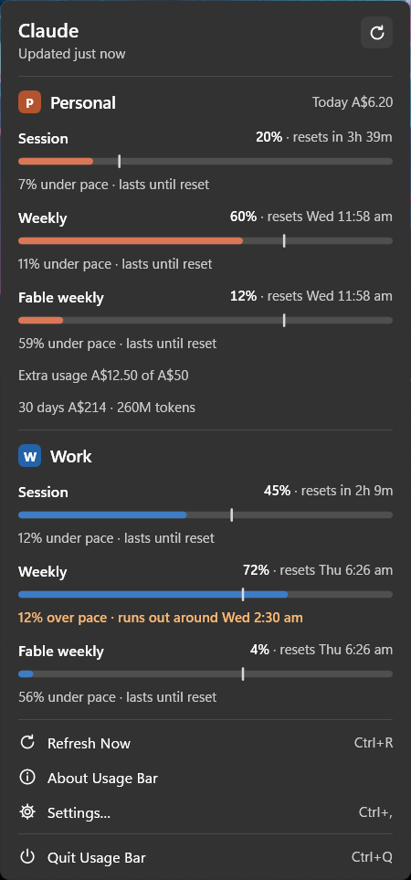
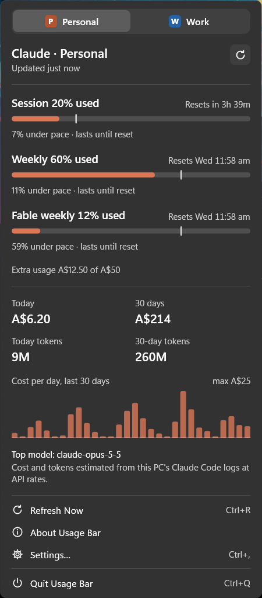
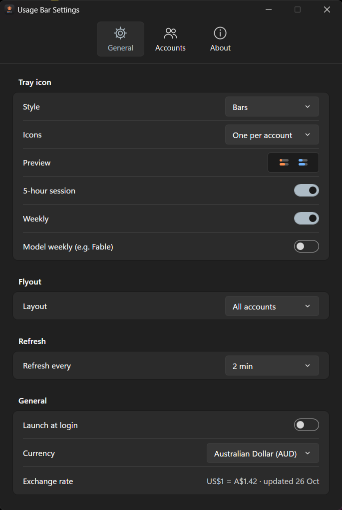
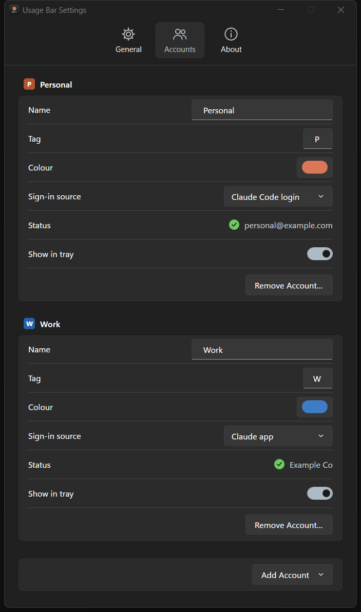
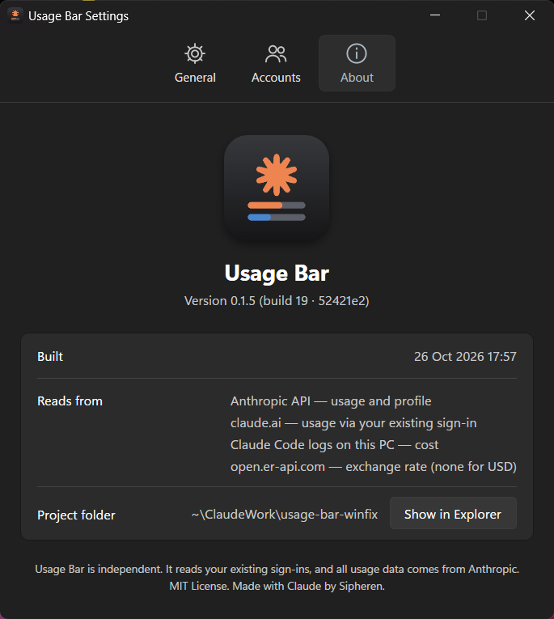
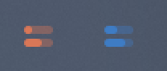
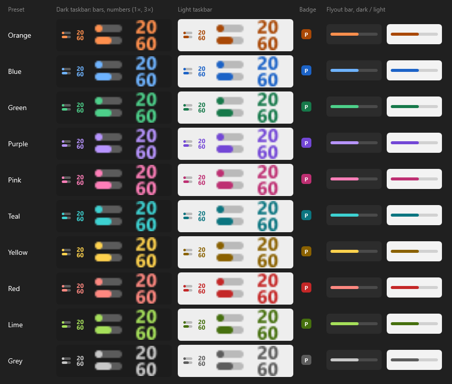

# Usage Bar for Windows

The Windows version of [Usage Bar](../README.md): a native notification-area (tray) app in C# on .NET 10
with WPF. It follows the macOS app, the reference implementation, in behaviour and look, and reproduces
its results on the shared test fixtures. No third-party runtime dependencies; the tests use xUnit.

Run every command below from the repository root.

| All accounts (default) | One at a time |
|---|---|
|  |  |

| General | Accounts | About |
|---|---|---|
|  |  |  |

Tray icons, one per account in its colour (in the overflow panel at 125% scaling, shown at 2×):


The ten account colours, as the app draws them on a dark and a light taskbar (real size and 3×), on the
tag badge and in the flyout:



The screenshots come from demo mode, so every number and name in them is made up.

## Requirements

- Windows 11. Built and checked on Windows 11 at 125% scaling; Windows 10 is untested.
- The .NET 10 SDK to build (it includes the runtime). <https://dotnet.microsoft.com/download/dotnet/10.0>
- For the Claude Code source: Claude Code signed in on this PC.
- For the Claude app source: the Claude desktop app signed in.

## Install

```powershell
bash scripts/setup-dev.sh                                              # once per clone, in Git Bash
powershell -ExecutionPolicy Bypass -File windows\scripts\install.ps1   # add -SkipTests to skip the tests
```

`install.ps1` checks for the .NET 10 SDK, runs the tests, stops a running copy, builds a Release copy
into `%LOCALAPPDATA%\Programs\UsageBar` and starts it. Remove it with `windows\scripts\uninstall.ps1`
(add `-Purge` to delete settings, state, the cost cache and logs too).

**Windows 11 puts new tray icons in the overflow** (the `^` next to the clock). Drag Usage Bar's icons onto
the taskbar and into the order you like, or turn them on in Settings > Personalization > Taskbar > Other
system tray icons. Windows remembers each account's icon separately.

## First-run setup

Open Usage Bar's flyout, then **Settings… > Accounts**. Each account has a **Sign-in source**:

| Source | What it reads (read-only) | What you do |
|---|---|---|
| Claude Code login | `.credentials.json` in Claude Code's config folder: `%USERPROFILE%\.claude`, or `%CLAUDE_CONFIG_DIR%` when set | Sign in to Claude Code once (`claude`). |
| Claude app | `%APPDATA%\Claude`: `config.json` (the encrypted token cache), `Local State` (its key, protected by Windows for your user) and, as a fallback, `Network\Cookies` | Click **Connect…**. Nothing is read before that. |

The first launch adds an account only for each sign-in it finds, with no prompt and nothing decrypted:
Personal when Claude Code's `.credentials.json` exists, and a Claude app account when the app's
`config.json` shows a sign-in to a different account than Claude Code's. Nothing found means no accounts:
the flyout and Settings say so and offer to add one. **Add Account** offers each sign-in source once (a
source already in use is greyed out), so Windows shows up to two accounts. If a Claude app account turns
out to be the same account as Claude Code, it says so and shows no numbers, so Personal is never shown
twice. Settings saved by an earlier version load as they are. The status row turns green with the account's email or organization when a source works,
and names the exact problem when it doesn't.

## Using it

- Left-click an icon for the flyout; click again or press Esc to close it. **Refresh Now** is Ctrl+R.
- Right-click an icon for Refresh Now, Settings…, About Usage Bar and Quit Usage Bar.
- Hover an icon for that account's limits and reset times.
- **Settings… > General**: the tray style (Bars, Percentages or Icon only), **Icons** (one per account,
  the default, or a single icon); bars and numbers are drawn in each account's colour, which limits the bars show, the flyout layout, the refresh interval
  (1, 2, 5 or 10 minutes), Launch at login (off by default, the per-user Run key) and the cost currency.
- **Settings… > Accounts**: rename accounts, set their tag and colour (one of ten presets that stay readable
  as small tray icons on dark and light taskbars), pick each sign-in source, hide an account from the tray,
  add accounts (one per sign-in source) or remove them.

Usage only refreshes when it's due: a launch or a flyout open fetches only if the last attempt is a
full refresh interval old, and a 429 pauses that account until its Retry-After passes.

## Files

| Path | What |
|---|---|
| `%APPDATA%\UsageBar\settings.json` | Settings |
| `%APPDATA%\UsageBar\state.json` | Each account's last numbers and fetch times, so relaunches don't refetch |
| `%APPDATA%\UsageBar\rates.json` | The day's exchange rates |
| `%LOCALAPPDATA%\UsageBar\cost-cache.json` | The cost scanner's incremental cache: token counts and id hashes, no content |
| `%LOCALAPPDATA%\UsageBar\logs\usagebar.log` | Statuses and counts only: never tokens, cookies, emails or organization names |

## Development

```bash
cd windows
dotnet build                                   # the solution: UsageBar.Core, UsageBar, UsageBar.Tests
dotnet test tests/UsageBar.Tests               # unit tests; parity tests skip without fixtures
USAGEBAR_FIXTURES=/path/to/usage-bar-fixtures dotnet test tests/UsageBar.Tests
```

- `src/UsageBar.Core` (net10.0) holds the logic ported from `macos/Sources/UsageBarCore`, with the macOS
  tests mirrored in `tests/UsageBar.Tests`. `FixtureParityTests` reproduce the macOS answer sheet
  (`expected.json`) from a fixtures folder; the fixtures are local test data and never go in the repository.
- `src/UsageBar` (net10.0-windows, WPF) is the tray app: `TrayController` and `IconRenderer` for the
  icons, `FlyoutWindow`, `MenuWindow`, `SettingsWindow`, `AppStore` for state and refresh, `DesktopSource`
  for the Claude app.

Options for running `src\UsageBar\bin\Debug\net10.0-windows\UsageBar.exe`:

| Option | Effect |
|---|---|
| `--demo` | Built-in sample data. Nothing is read, fetched or saved. Use it for anything visual. |
| `--fixtures <dir>` | Adds a Work test account answered from a fixtures folder (never saved); timestamps move to now. Set `USAGEBAR_FIXTURE_ERROR` to `401`, `403`, `429` or `cloudflare` to serve an error file. |
| `--open flyout\|menu\|settings\|accounts\|about` | Opens that view after start. |
| `--theme light\|dark` | Forces a theme. |
| `--layout one`, `--style bars\|percentages\|icon`, `--icons single` | Demo mode only: screenshot variants. |
| `--demo-accounts 0\|1\|2` | Demo mode with that many accounts (Personal, then Work); 0 shows the "No accounts" views. |
| `--detect-sign-ins <file>` | Writes what a first run would add (found or not found only, never ids or tokens) and exits. |
| `--scenario edge` | Demo mode only: eight accounts in every awkward state (long names and emails, over the limit, not started, rate limited, offline, not connected), enough to make the flyout scroll. |
| `--selftest <report>` | Demo data: opens and closes the tray icons, flyout, menu and Settings hundreds of times over three rounds, writes GDI, USER, handle and memory counts after each phase to the report, and exits. Growth that repeats every round is a leak. |
| `--desktop-shape <file>` | Writes the key names and value types of the Claude app's decrypted token cache, never values. |
| `--write-icon <file>` | Writes the app icon (`.ico`) from `design/icon` and exits. |
| `--colour-sheet <file>` | Writes a PNG of every colour preset as the tray and flyout draw it, and exits. |

A second launch opens the running copy's flyout. Judge the UI from real screenshots of the running app;
images for `docs/images` come from demo mode.

## How it differs from the Mac

- **The tray holds icons, not a label.** Each icon is a square (16 px at 100% scaling, 20 px at 125%), so
  the Mac's `✳ P [bars] W [bars]` becomes one icon per account showing its two bars, or its session and
  weekly percentages, in the account's colour (decision 17): colour, not a letter, tells accounts apart.
  The single-icon option shows the first account the same way, or the spark. Compact isn't offered: it
  reads the same as Percentages in a square.
- **No Safari source.** A browser source isn't built yet: Chrome encrypts cookies with app-bound
  encryption that only Chrome can undo; Firefox is the candidate (docs/PORTING.md).
- **The light flyout has no blur.** Over Windows 11's acrylic, dark anti-aliased text loses its thin
  strokes, so the light theme draws on a solid surface. The dark theme keeps the acrylic.
- **Switches use your Windows accent colour**, as Windows' own controls do.
- **About has no "Signed by" row**: the build isn't code-signed, so SmartScreen may warn about a copy
  downloaded from elsewhere. A copy you build yourself isn't affected.
